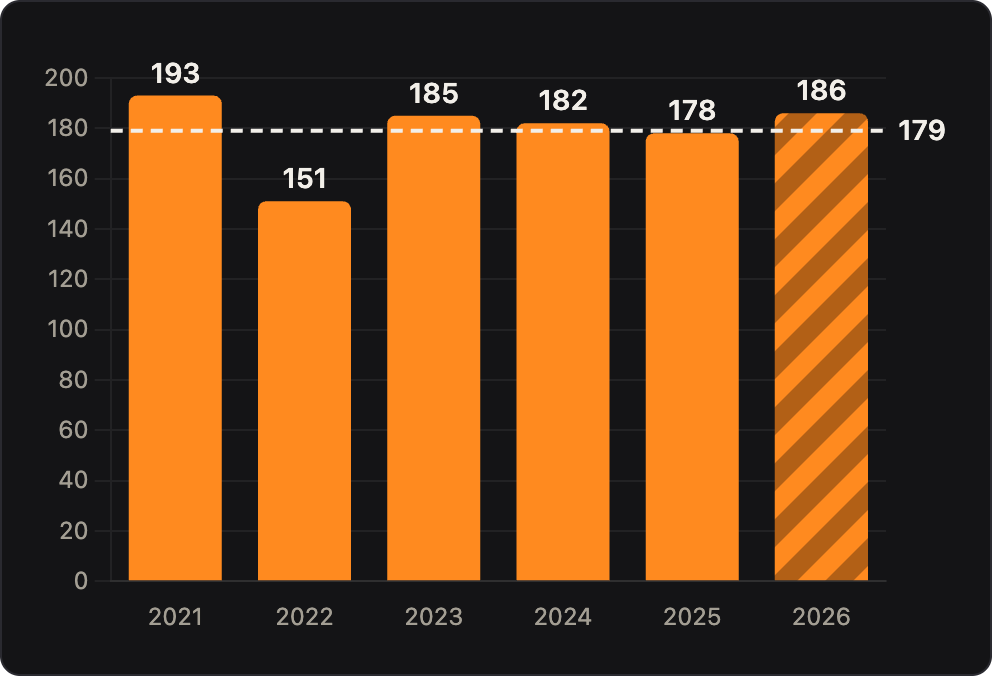
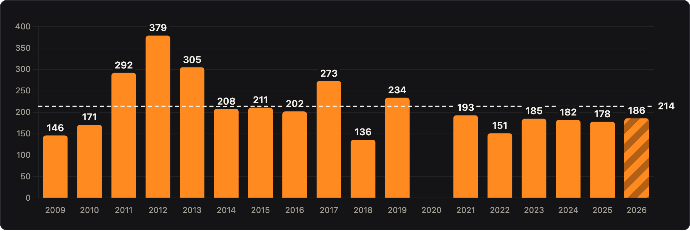
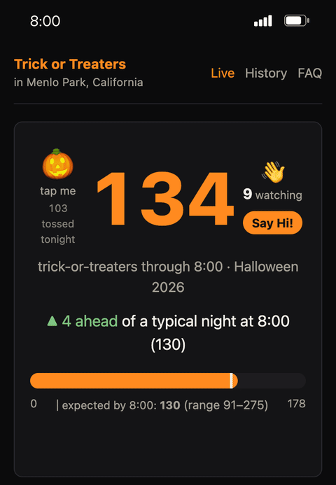
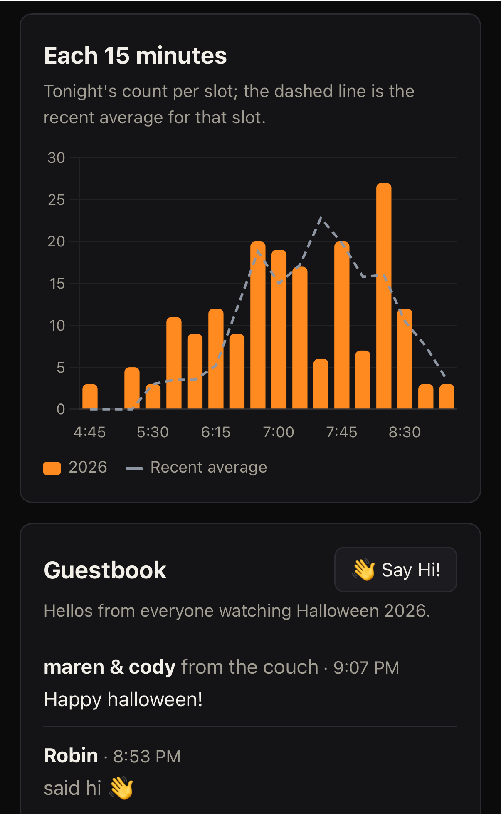

<!--
.. title: Spooky Consistency! 🎃🎃
.. slug: halloween-2026
.. date: 2026-11-02 15:00:00 UTC-08:00
.. tags: Life,Family,Data
.. type: text
-->

Halloween 2026 is in the books now. We had 186 trick-or-treaters on Saturday
night. A very respectable showing and a lovely evening.

What's surprising to me, year over year, is how consistent our count is, at least
for the past six years. It's not like it's always the same families, or that our
neighborhood is stuck. We're seeing a ton of new young families in The Willows,
which makes it all the more surprising that it doesn't move the numbers much.

Well, at least since COVID. We did have some banner years, including about 2x
our current amount in the nutty year of 2012. That year was nuts. This is the
whole history so far.

## New This Year: Live Tracking!

The big new thing this year was an app. You can try it out for yourself at
[halloween.kloninger.com](https://halloween.kloninger.com/). What you see if you
go there now are some charts showing trends, but during the night-of, when we
were doing the count, the [live page] was up showing the current tally. People
have been asking me for that for years.

Here are a couple of screenshots of what it looked like on mobile. The guestbook
and little "throwing pumpkins" interaction was fun.

There are a bunch of other charts [up there][] too. I especially like the heat
map, check that out.

I don't plan on maintaining the old [Google Spreadsheet][] version anymore. It
had a good run, but this is way more fun.

[live page]: https://halloween.kloninger.com/live
[up there]: https://halloween.kloninger.com/history/
[Google Spreadsheet]: https://docs.google.com/spreadsheets/d/1w-7ftYzue_VQl4lt-QNFU_UfeDAROg47-1tlOzIw5Vk/edit?gid=15#gid=15
